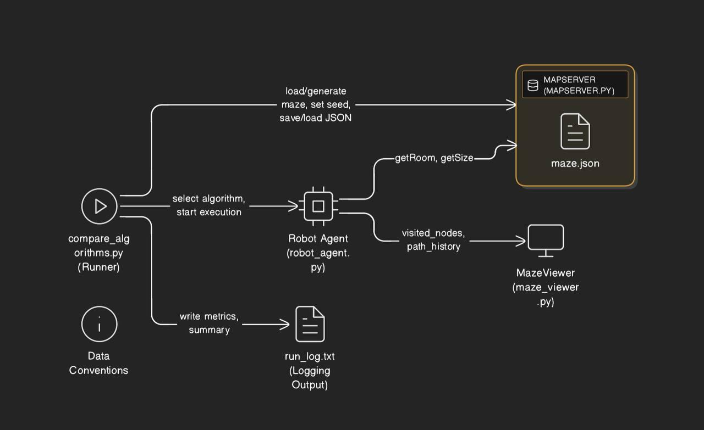
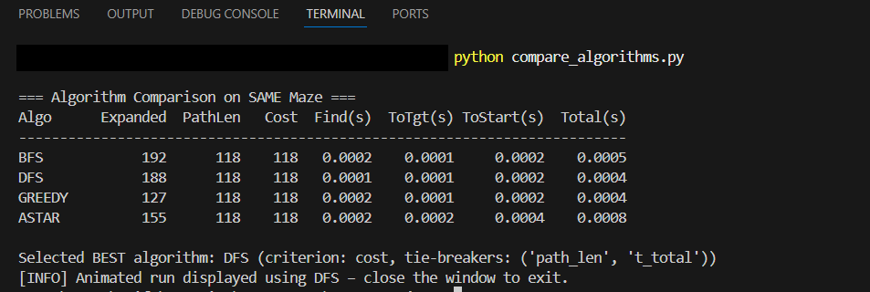
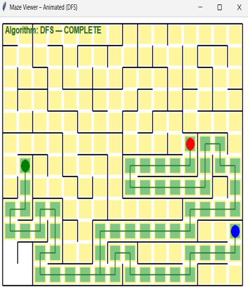
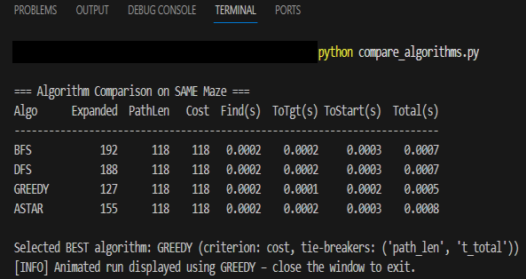
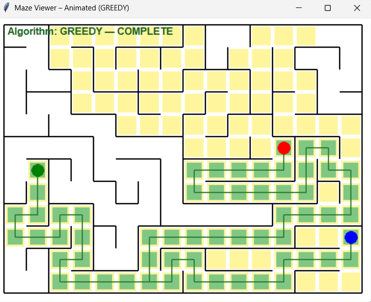

<i>Intelligence is not just finding a destination, but discovering the best way to reach it.</i>

---

## 01 // Project Overview

This project focuses on the development of an AI-based autonomous robot path-planning system within a simulated maze environment.

We developed a Python application that enables a robot to locate an object, collect it, deliver it to a designated target, and return to its starting position.

The system implements four AI search algorithms from scratch, without relying on pre-built pathfinding libraries, and compares their performance under identical environmental conditions.

---

## 02 // Project Objectives

- Develop an autonomous maze navigation system.
- Implement informed and uninformed search algorithms.
- Explore heuristic-based path planning.
- Generate and manage grid-based environments.
- Visualize robot movements and search behavior.
- Compare algorithm efficiency and performance.
- Automatically select the best-performing algorithm.

---

## 03 // System Profile

<table>
<tr><th>Property</th><th>Details</th></tr>
<tr><td>Project Domain</td><td>Artificial Intelligence and Robotics</td></tr>
<tr><td>Programming Language</td><td>Python</td></tr>
<tr><td>Graphical Interface</td><td>Tkinter</td></tr>
<tr><td>Environment</td><td>2D Grid-Based Maze</td></tr>
<tr><td>Search Algorithms</td><td>BFS, DFS, Greedy, A*</td></tr>
<tr><td>Heuristic Function</td><td>Manhattan Distance</td></tr>
<tr><td>Data Storage</td><td>JSON</td></tr>
<tr><td>Navigation Type</td><td>Autonomous Robot Simulation</td></tr>
</table>

---

## 04 // Technical Arsenal

---

## 05 // My Contribution

I actively contributed to the design and development of the robot path-planning system, including problem formulation, maze environment modeling, and the implementation of all four AI search algorithms: BFS, DFS, Greedy Best-First Search, and A*.

My work involved both informed and uninformed search strategies, heuristic-based navigation, and MapServer development.

### Key Contributions

- AI problem formulation.
- Search strategy design and evaluation.
- MapServer development.
- Grid-based environment modeling.
- Breadth-First Search (BFS) implementation.
- Depth-First Search (DFS) implementation.
- Greedy Best-First Search implementation.
- A* Search implementation.
- Heuristic-based path planning.
- Technical documentation.

---

## 06 // System Architecture

<table>
<tr><th>Module</th><th>Functionality</th></tr>
<tr><td>MapServer</td><td>Maze generation, wall management, movement costs, and JSON storage</td></tr>
<tr><td>Robot Agent</td><td>Search algorithm execution and path reconstruction</td></tr>
<tr><td>MazeViewer</td><td>Graphical maze visualization and animated robot navigation</td></tr>
<tr><td>Comparison Runner</td><td>Performance measurement, algorithm comparison, and automatic selection</td></tr>
</table>

---

## 07 // Robot Navigation Workflow

<table>
<tr><td align="center">Maze Generation</td></tr>
<tr><td align="center">↓</td></tr>
<tr><td align="center">Environment and Goal Configuration</td></tr>
<tr><td align="center">↓</td></tr>
<tr><td align="center">Search Algorithm Execution</td></tr>
<tr><td align="center">↓</td></tr>
<tr><td align="center">Start → Object</td></tr>
<tr><td align="center">↓</td></tr>
<tr><td align="center">Object Collection</td></tr>
<tr><td align="center">↓</td></tr>
<tr><td align="center">Object → Target</td></tr>
<tr><td align="center">↓</td></tr>
<tr><td align="center">Target → Start</td></tr>
<tr><td align="center">↓</td></tr>
<tr><td align="center">Performance Evaluation and Visualization</td></tr>
</table>

---

## 08 // Search Algorithms

### Breadth-First Search (BFS)

An uninformed search strategy that explores nodes level by level using a queue.

BFS guarantees the shortest path in a uniform-cost environment but may require significant memory.

### Depth-First Search (DFS)

An uninformed search strategy that explores individual branches deeply before backtracking.

DFS can be memory-efficient but does not guarantee an optimal path.

### Greedy Best-First Search

An informed search strategy that prioritizes nodes according to their estimated distance from the goal.

Evaluation function:

**f(n) = h(n)**

Greedy Search can reduce node exploration but does not guarantee an optimal solution.

### A* Search

An informed search strategy that combines the actual movement cost with an estimated remaining cost.

Evaluation function:

**f(n) = g(n) + h(n)**

A* provides optimal solutions under appropriate heuristic and search conditions.

---

## 09 // Heuristic Function

The system uses Manhattan Distance to estimate the remaining distance between the robot and its destination.

**h(n) = |x1 - x2| + |y1 - y2|**

This heuristic is suitable for grid-based navigation where movement is restricted to four cardinal directions.

---

## 10 // Performance Evaluation

The four search algorithms were evaluated using the same maze configuration.

### Evaluation Metrics

- Number of expanded nodes.
- Total path length.
- Total movement cost.
- Algorithm execution time.
- Solution optimality.

### Algorithm Comparison

<table>
<tr><th>Algorithm</th><th>Expanded Nodes</th><th>Execution Time</th><th>Optimality Guarantee</th></tr>
<tr><td>BFS</td><td>192</td><td>0.0006 s</td><td>Uniform-cost environments</td></tr>
<tr><td>DFS</td><td>189</td><td>0.0004 s</td><td>No</td></tr>
<tr><td>Greedy</td><td>127</td><td>0.0005 s</td><td>No</td></tr>
<tr><td>A*</td><td>142</td><td>0.0009 s</td><td>Under appropriate conditions</td></tr>
</table>

The results represent a specific maze configuration and may vary across different environments.

---

## 11 // Findings and Results

The system successfully demonstrated autonomous navigation, object collection, target delivery, path reconstruction, and algorithm comparison.

### Key Findings

- DFS achieved the fastest execution time in the tested maze.
- Greedy Search expanded the fewest nodes.
- BFS guarantees the shortest path in a uniform-cost environment.
- A* combines heuristic guidance with cost-based path planning.

The system automatically selected DFS for the reported sample run, while A* was recommended for general-purpose optimal path planning.

---

## 11.1 // Implementation and Results

### 01 - System Architecture

The system architecture illustrates the interaction between MapServer, Robot Agent, MazeViewer, and the Comparison Runner.

### 02 - Algorithm Comparison - DFS

The system evaluates search algorithm performance based on expanded nodes, path length, execution time, and movement cost.

### 03 - DFS Maze Navigation

The visualization demonstrates autonomous robot navigation and path reconstruction using Depth-First Search.

### 04 - Algorithm Comparison - Greedy Search

The performance results demonstrate heuristic-based search and node exploration efficiency.

### 05 - Greedy Maze Navigation

The graphical simulation demonstrates autonomous maze navigation using Greedy Best-First Search.

---

## 12 // System Features

- Random maze generation.
- JSON-based maze loading and saving.
- Autonomous robot navigation.
- Wall and obstacle avoidance.
- Object collection and delivery.
- Animated path visualization.
- Visited-node visualization.
- Automatic algorithm comparison.
- Performance logging.

---

## 13 // Future Improvements

- Dynamic obstacle detection.
- Multiple object collection.
- Variable movement costs.
- Real-time path re-planning.
- Larger maze environments.
- Advanced heuristic optimization.

---

## 14 // Skills Demonstrated

---

## 15 // Academic Information

**University:** University of Prince Mugrin (UPM)

**College:** College of Computer and Cyber Sciences

**Department:** Cybersecurity and Forensic Computing

**Course:** AI381 - Artificial Intelligence

**Project Type:** Collaborative Artificial Intelligence Project

---

## 16 // References

- [Artificial Intelligence: A Modern Approach](https://aima.cs.berkeley.edu/)
- [A Formal Basis for the Heuristic Determination of Minimum Cost Paths](https://doi.org/10.1109/TSSC.1968.300136)
- [Introduction to Algorithms](https://mitpress.mit.edu/)
- [Python Documentation](https://docs.python.org/3/)

---

## 17 // Disclaimer

This project was developed for educational and artificial intelligence research purposes at the University of Prince Mugrin.

The system represents a simulated autonomous navigation environment rather than a physical robotic implementation.

---

  

<i>Question everything. Trust the evidence.</i>

  

<b>M O O N W 4 R E</b>

